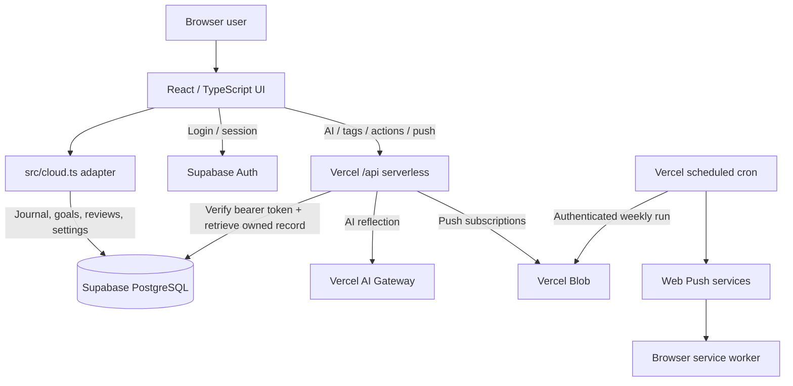
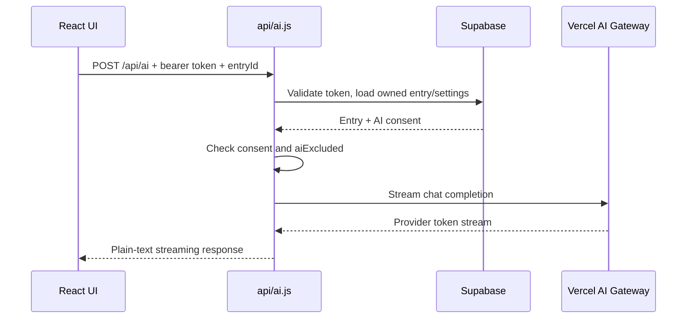

# Mind Blogging — Tech Stack & Architecture Reference

> **Purpose:** Explain how this application is built and how data moves through the system.  
> **Source:** `main` branch of [jd2009-k/mind-blogging](https://github.com/jd2009-k/mind-blogging), reviewed on 26 October 2026.  
> **Companion slides:** [Mind Blogging Tech Stack & Architecture PowerPoint](./Mind_Blogging_Tech_Stack_Architecture.pptx) (generated by `scripts/build_architecture_pptx.py`).

## 1. Technology stack

| Layer | Implementation | Reference |
|---|---|---|
| UI | React 19, TypeScript 5.7, Vite 6 | `src/main.tsx`, `src/App.tsx` |
| UI styling | Tailwind CSS 3.4, custom CSS, Lucide icons | `src/*.css`, `tailwind.config.js` |
| Workspace | React components and hooks | `src/PlayfulWorkspace.tsx` |
| Data adapter | Supabase JS 2.x | `src/cloud.ts` |
| Auth | Supabase Auth | `src/cloud.ts`, `src/PlayfulLogin.tsx` |
| Database | Supabase PostgreSQL, `mind_blog_records` | `src/cloud.ts` |
| Backend | Vercel serverless functions | `api/*.js` |
| AI | Vercel AI Gateway, server-side streaming | `api/ai.js` |
| Push reminders | Web Push, VAPID, Vercel Blob, Vercel Cron | `api/push.js`, `api/cron.js`, `public/sw.js` |
| Hosting | Vercel | `vercel.json` |
| Version control | Git + GitHub | Repository |
| Tests | Node built-in test runner; TypeScript and Vite checks | `tests/release.test.mjs`, `package.json` |

Versions are ranges declared in `package.json`, not confirmation of production-installed versions.

## 2. Architecture: two distinct request paths



**Important:** `api.post('/api/entries', …)` in a React component is handled *locally* by `src/cloud.ts` and writes to Supabase. It does **not** issue a browser network request to `/api/entries` on Vercel. In contrast, `fetch('/api/ai', …)` really does invoke a Vercel API function.

## 3. Frontend entry points

1. `src/main.tsx` mounts React into the page.
2. `src/App.tsx` shows `PlayfulProfile` first and enters `PlayfulWorkspace`.
3. `src/PlayfulLogin.tsx` provides email/password, email-link, and Google sign-in interfaces.
4. `src/PlayfulWorkspace.tsx` contains journal, goals, reviews, search, navigation and settings.
5. `src/PlayfulAdvanced.tsx` contains optional AI reflection, tagging, export and reminders.
6. `src/MindBlog.tsx` is a substantial alternative UI implementation but **is not** the current `App.tsx` entry path.

## 4. Identity and authorization

- The client uses `@supabase/supabase-js` with session persistence and token refresh.
- Email/password, email-link and Google OAuth methods are implemented in `src/cloud.ts`. Google depends on the Supabase Google provider being enabled.
- Client calls to protected serverless routes send `Authorization: Bearer <access token>`.
- `api/_shared.js` checks tokens with Supabase Auth and returns an authenticated user.
- Database RLS **must** isolate rows by `user_id`. Source query filters alone are not a substitute for verified RLS policies.
- The publishable Supabase key can appear in browser code; privileged keys and AI/push credentials belong only on the server.

## 5. Database design and journal save

The client reads and writes `public.mind_blog_records`, storing `{user_id, kind, id, payload}`. The `kind` distinguishes `entries`, `artifacts`, `goals`, `reviews`, and `settings`. Writes use a composite conflict key `user_id,kind,id`.

```typescript
const {error} = await sb.from('mind_blog_records').upsert({
  user_id: user.id,
  kind,
  id: record.id,
  payload: record
}, {onConflict: 'user_id,kind,id'});
```

Save sequence: user edits form → React draft state → workspace calls `api.post('/api/entries', …)` → `src/cloud.ts` `request()` → authenticated Supabase `upsert()` → local React state refresh. Edits may include `expectedVersion` for conflict detection.

## 6. AI request path



The default model identifier in source is `openai/gpt-5.4-nano`, overridable via `AI_GATEWAY_MODEL`. Credentials are provided server-side through `AI_GATEWAY_API_KEY` or `VERCEL_OIDC_TOKEN`. AI consent and entry exclusion are checked before generation. `api/suggest-tags.js` is deterministic keyword matching, **not** an AI model inference call.

## 7. Web push and scheduled reminders

1. Browser requests permission and registers `public/sw.js`.
2. `src/cloud.ts` subscribes with the server's VAPID public key.
3. `api/push.js` checks authentication/preferences and saves per-user subscriptions to private Vercel Blob objects.
4. `vercel.json` schedules `GET /api/cron` at `30 3 * * 1` (Monday 03:30 UTC / 09:00 IST).
5. `api/cron.js` requires `CRON_SECRET` and dispatches Web Push payloads.
6. `public/sw.js` displays notifications and handles clicks.

## 8. Security boundaries

- Signed-in user identity and access checks for serverless functions.
- Database ownership enforcement depends on actual Supabase RLS configuration.
- Explicit user AI consent and per-entry opt-out.
- `/api/cron` rejects non-GET requests and requests with missing or incorrect bearer secret.
- Version checks help prevent conflicting edits.
- Account erasure requests push-subscription deletion before deleting records.
- No deployed configuration should include service-role keys in client bundles.
- Source checks and endpoint smoke tests do **not** establish end-to-end security.

## 9. Deployment and local development

Install Node.js 20 or newer.

```bash
git clone https://github.com/jd2009-k/mind-blogging.git
cd mind-blogging
npm install
npm run dev
npm run check
npm run test
npm run build
```

Vite serves the frontend locally. The `api/*.js` functions need a Vercel-compatible local runtime or deployment to exercise them end-to-end. Configure Vercel secrets privately and allow the actual deployed origins in Supabase Auth redirects.

## 10. Quality and production caveats

The [26 October 2026 QA report](../QA_REPORT_2026-10-26.md) reports passing source type checks, builds, regression tests, and guest API smoke tests for a preview. The report also explicitly states **not verified end-to-end**: account registration/confirmation, real database CRUD, AI streaming and cancellation with a signed-in account, and physical device push delivery. Production was not promoted to that preview. Do not treat this deck as proof of production readiness.

## 11. Suggested reading order

JavaScript and async/await → TypeScript → React hooks → `src/App.tsx` → `src/PlayfulWorkspace.tsx` → `src/cloud.ts` → Supabase Auth and RLS → `api/_shared.js` and `api/ai.js` → `api/push.js` / `api/cron.js` → Vercel deployments.

## 12. Presentation source

The editable companion presentation is generated from `scripts/build_architecture_pptx.py`. To rebuild:

```bash
python -m pip install python-pptx==1.0.2
python scripts/build_architecture_pptx.py
```

A GitHub Actions workflow (when enabled and permitted to write) publishes the generated deck at `docs/Mind_Blogging_Tech_Stack_Architecture.pptx`. The source file, not the exported binary, is the maintainable reference for how it was assembled.
